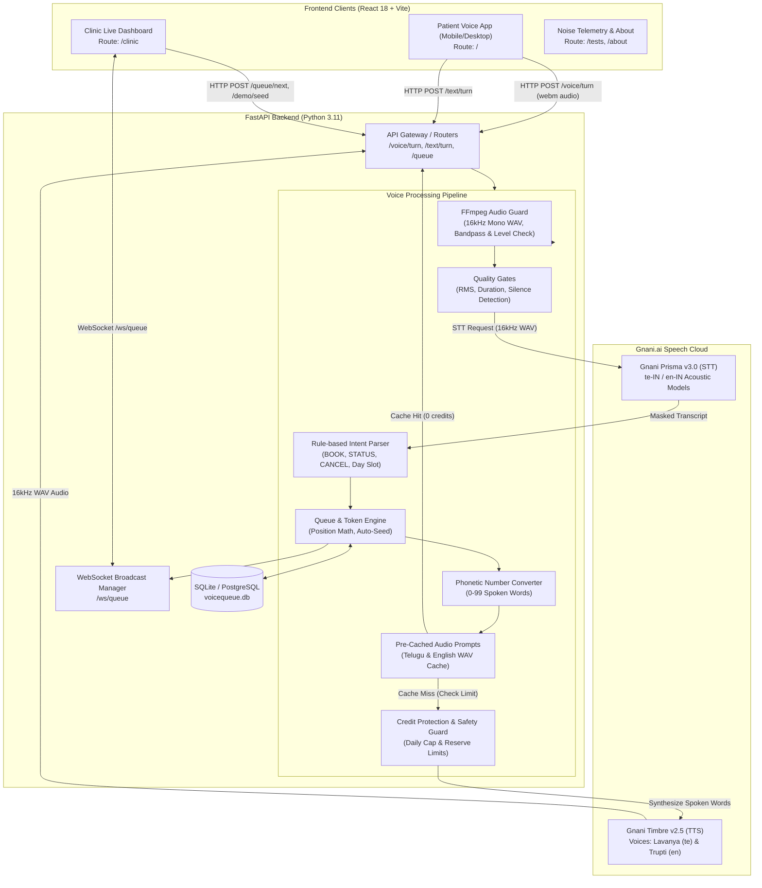
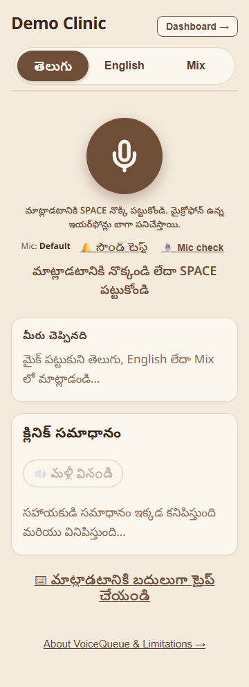
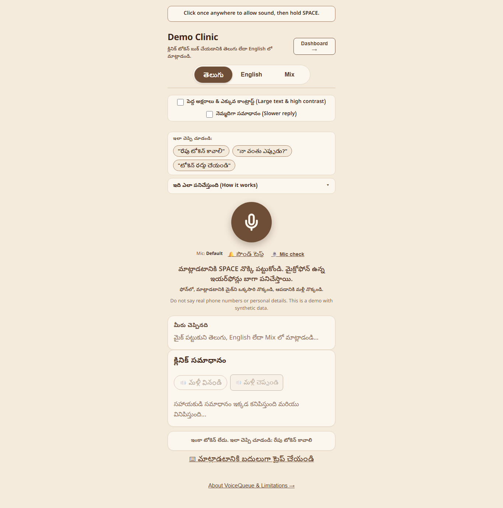
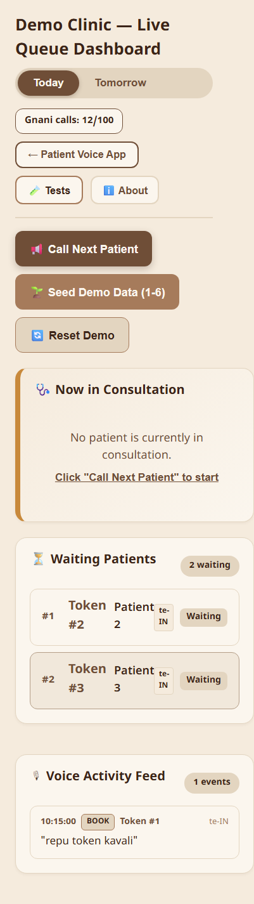
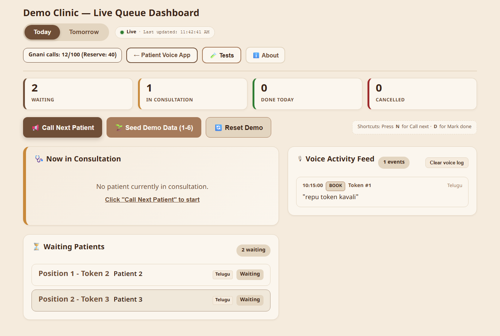
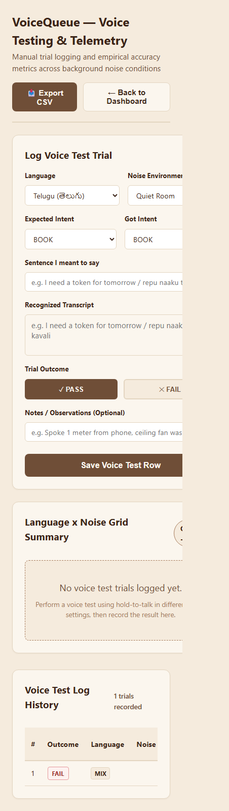
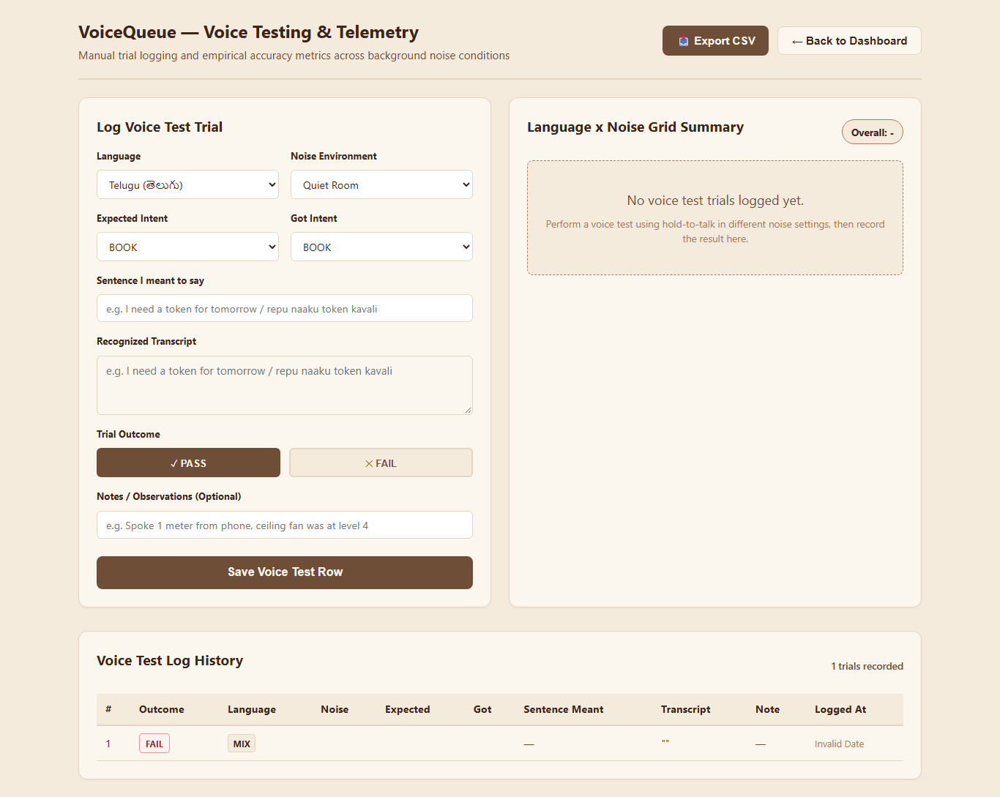
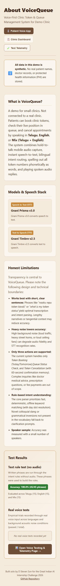
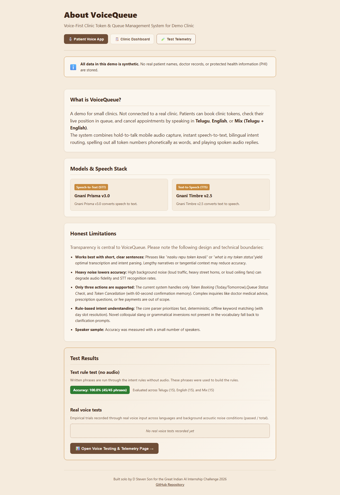

# VoiceQueue

> **Voice-first outpatient clinic token and queue management assistant for patients speaking Telugu, English, or conversational Mix.**

[](https://github.com/stevejoy-9381/VoiceQueue-gnani.ai-/actions)
[](LICENSE)
[](https://www.python.org/)
[](https://react.dev/)
[](https://docs.gnani.ai)

---

## 1. The Problem

In Indian outpatient departments (OPDs) and community clinics, token booking and waiting lines are chaotic, noisy, and stressful:
- **Digital divide & literacy barriers**: Patients who cannot read, write, or navigate touchscreen kiosks are forced to stand in long physical lines.
- **Paper token slips**: Hand-written paper slips get lost, damaged, or miscalled over clinic loudspeakers.
- **Language exclusion**: Standard hospital management systems only operate in formal English or complex menus, ignoring colloquial spoken Telugu and bilingual code-switching (Telugu + English).
- **Elderly discomfort**: Small screen fonts, subtle tap targets, and rapid robotic synthesized voices make digital self-service unusable for older visitors.

**VoiceQueue** eliminates these barriers with an intuitive, accessible **voice-first assistant**. Patients tap or hold a single microphone button, speak naturally in Telugu, English, or conversational Mix, and receive instant spoken and visual confirmations.

---

## 2. Who It Is For

- **Patients (Walk-in & OPD Visitors)**:
  - Can book a token for *Today* or *Tomorrow* in under 20 seconds without reading instructions.
  - Can check their queue position anytime (*"How many patients are ahead of me?"*).
  - Can cancel an appointment with a safe 60-second confirmation flow.
  - Can enable **Elder-Friendly Mode** (large text, high-contrast coffee-cream palette, 0.85x slower speech, and 64px+ touch targets).
- **Receptionists & Front-Desk Staff**:
  - Live operational dashboard with real-time WebSocket token streaming.
  - Single-click or keyboard-driven queue progression (**N** for *Call next*, **D** for *Mark done*).
  - Live Voice Activity Feed showing masked speech transcripts and intent classifications.
- **Clinics & Healthcare Providers**:
  - Zero Protected Health Information (PHI) exposure — built-in privacy masking for phone numbers and names.
  - Strict daily API cost caps and reserve limits to prevent unexpected billing.

---

## 3. Core Features

### Patient Experience (`/`)
- **Hold-to-Talk & Tap-to-Talk**: Hold SPACE on desktop or tap once to start/stop on mobile.
- **3 "Try Saying" Suggestion Chips**: Contextual chips in Telugu, English, or Mix to get started in one click without using the microphone.
- **Subtitled Spoken Replies**: Every Telugu voice response includes a built-in English translation.
- **Elder-Friendly Mode**:
  - `Large text & high contrast`: +30% larger fonts, high-contrast dark coffee text on cream background.
  - `Slower reply`: Plays voice replies at 0.85x speed with pitch preservation enabled.
  - 64px+ tap targets for Replay and Yes/No confirm buttons.
  - Single-tap "Say that again" button to replay the last spoken reply without any API call.
- **Built-in Mic Check**: 3-second recording tool measuring RMS audio levels, peak volume, and ambient noise without consuming API credits.
- **Zero-Digit Phonetic Numbers**: Spoken numbers (0–99) are converted into natural phonetic words (e.g., Telugu *"పదకొండు"*, English *"eleven"*). Raw numeric digits are never sent to the voice synthesizer.
- **Pre-Cached Prompts**: Common greetings, confirmations, and pauses are pre-rendered into high-quality WAV files, eliminating latency and preserving API quota.

### Clinic Dashboard (`/clinic`)
- **Live WebSocket Stream (`/ws/queue`)**: Instant synchronization of token bookings, consultations, and cancellations across all screens.
- **Tabbed Views**: Seamless switching between *Today* and *Tomorrow* queues.
- **Summary Counters**: Live cards for *Waiting*, *In Consultation*, *Done Today*, and *Cancelled*.
- **Keyboard Shortcuts**: Press **N** to call the next patient, **D** to complete a consultation, and **Shift+R** to reset and seed demo data.
- **Presentation Mode (`?present=1`) & Clean Video Mode (`?clean=1`)**: Automatically hides developer badges, credit meters, and technical labels for screen recordings and clean presentations.

### Telemetry & Audio Lab (`/tests` & `/audio-lab?dev=1`)
- **Noise Telemetry Matrix**: Live testing dashboard logging speech recognition accuracy across background noise profiles (*Quiet*, *Fan/AC*, *Street/Traffic*).
- **Audio Comparison Lab**: Side-by-side playback and transcript comparison of raw vs. cleaned audio with CSV export.
- **Monotonic Latency Profiler (`?dev=1`)**: Precise stage-by-stage timing breakdown (audio conversion, noise cleaning, STT, NLU, queue action, TTS).

---

## 4. Supported Languages

VoiceQueue provides native support for three language modes:

1. **Telugu (`te-IN`)**:
   - Synthesized using Gnani Timbre voice **`Lavanya`**.
   - Spoken numbers rendered in Telugu script words (*ఒకటి, రెండు, మూడు...*).
   - Fully reviewed against native colloquial phrasing rules.
2. **English (`en-IN`)**:
   - Synthesized using Gnani Timbre voice **`Trupti`**.
   - Spoken numbers rendered in English words (*one, two, three...*).
3. **Mix Mode (Telugu + English Code-Switching)**:
   - Understands hybrid sentences with English nouns and Telugu verbs (e.g., *"repu clinic appointment book cheyyandi"*, *"my token status cheppandi"*).
   - Automatically detects dominant language by counting Telugu Unicode characters vs. Latin words (excluding loanwords like *token*, *clinic*, *doctor*, *appointment*).
   - Employs Gnani Prisma's language detector as an intelligent tie-breaker.

---

## 5. Architecture



---

## 6. AI Models & Versions Used

| Capability | Model / Service | Version | Configuration / Voice | Purpose |
| :--- | :--- | :--- | :--- | :--- |
| **Speech-to-Text (STT)** | [Gnani Prisma](https://docs.gnani.ai) | `v3.0` | `te-IN`, `en-IN` (16kHz mono WAV) | Real-time Indian accent speech recognition. |
| **Text-to-Speech (TTS)** | [Gnani Timbre](https://docs.gnani.ai) | `v2.5` | `Lavanya` (Telugu), `Trupti` (English) | High-fidelity neural voice synthesis with natural Indic prosody. |
| **Intent Understanding** | Deterministic NLU | `v2.0` | Offline regex & token slot parsing | Zero-latency, deterministic intent classification for BOOK, STATUS, and CANCEL. |
| **Fallback Parser (Optional)** | Groq Llama | `3.1-8b-instant` | Temperature `0.0`, strict JSON mode | Fallback for non-standard grammatical inversions (masked text only). |

---

## 7. Visual Screenshots

Screenshots captured across mobile (360x740) and desktop (1366x768) resolutions:

| Screen | Mobile Viewport (360x740) | Desktop Viewport (1366x768) |
| :--- | :---: | :---: |
| **Patient Voice App** |  |  |
| **Clinic Dashboard** |  |  |
| **Noise Telemetry Suite** |  |  |
| **About & Review Status** |  |  |

---

## 8. How to Run in 5 Minutes

### Prerequisites
- **Python 3.11+**
- **Node.js 18+** & npm
- **FFmpeg** installed and accessible on system `PATH` (used for 16kHz mono WAV conversion)

### Step 1: Clone Repository and Configure Environment
```bash
git clone https://github.com/stevejoy-9381/VoiceQueue-gnani.ai-.git
cd VoiceQueue-gnani.ai-
cp .env.example .env
```

Edit `.env` and set your Gnani credentials:
```env
GNANI_API_KEY=your_actual_key_here
VOICE_TE=Lavanya
VOICE_EN=Trupti
GNANI_DAILY_CAP=150
```
*(If no API key is provided, VoiceQueue runs with pre-cached audio and typed inputs remain 100% functional).*

### Step 2: Install and Start Backend
```bash
# Install Python dependencies
pip install -r backend/requirements.txt

# Run backend API server
uvicorn backend.app.main:app --reload --port 8000
```
- Health Check: `http://localhost:8000/health`
- OpenAPI Documentation: `http://localhost:8000/docs`

### Step 3: Install and Start Frontend
In a separate terminal:
```bash
cd frontend
npm install
npm run dev
```

Open in your browser:
- **Patient Voice App**: [http://localhost:5173/](http://localhost:5173/)
- **Clinic Dashboard**: [http://localhost:5173/clinic](http://localhost:5173/clinic)
- **Telemetry Tests**: [http://localhost:5173/tests](http://localhost:5173/tests)
- **About & Review Pipeline**: [http://localhost:5173/about](http://localhost:5173/about)

---

## 9. Environment Variables Reference

| Variable | Type | Default | Description |
| :--- | :--- | :--- | :--- |
| `GNANI_API_KEY` | String | `""` | Gnani API access key for Prisma STT and Timbre TTS. |
| `VOICE_TE` | String | `"Lavanya"` | Allowed Timbre-v2.5 Telugu voice (`Lavanya`, `Lehara`, `Suhana`, etc.). |
| `VOICE_EN` | String | `"Trupti"` | Allowed Timbre-v2.5 English voice (`Trupti`, `Devika`, `Pranav`, etc.). |
| `GNANI_DAILY_CAP` | Integer | `150` | Maximum billable Gnani calls permitted per day before emergency auto-pause. |
| `GNANI_RESERVE` | Integer | `40` | Reserved calls remaining when warning amber meter activates. |
| `RATE_LIMIT_VOICE_10MIN`| Integer | `6` | Maximum voice turns allowed per IP address in any 10-minute sliding window. |
| `RATE_LIMIT_VOICE_DAILY`| Integer | `30` | Maximum voice turns allowed per IP address per calendar day. |
| `SESSION_VOICE_CAP` | Integer | `10` | Maximum voice turns allowed per browser session before forcing text input. |
| `OWNER_KEY` | String | `""` | Secret authorization token to bypass rate limits and reset meters. |
| `DATABASE_URL` | String | `sqlite:///./voicequeue.db` | SQLAlchemy connection string (SQLite or PostgreSQL). |
| `CORS_ORIGINS` | String | `http://localhost:5173,...` | Comma-separated allowed origins (set to frontend URL in production). |
| `DEMO_AUTOSEED` | Boolean | `false` | When `true`, automatically seeds 4 demo tokens if queue is empty on startup. |
| `ALERT_VOICE` | Boolean | `false` | When `true`, plays spoken alert audio on the patient page when called (default `false` shows banner only). |
| `PORT` | Integer | `8000` | Port bound by Uvicorn in containerized deployments. |
| `AUDIO_CLEAN` | Boolean | `true` | Enables automatic audio high-pass filtering and volume normalization. |
| `DEBUG_SAVE_AUDIO` | Boolean | `false` | Enables temporary storage of raw audio clips for the `/audio-lab` tool. |
| `DEV_ENDPOINTS` | Boolean | `false` | Enables `/dev/latency` endpoint for statistical latency benchmarking. |
| `VITE_API_URL` | String | `""` | *(Frontend only)* Backend base URL for deployed frontend (e.g. on Vercel). |

---

## 10. How to Run Automated Tests

VoiceQueue includes a comprehensive, multi-layer testing suite:

### 1. Backend Integration & Unit Tests (Pytest)
Runs all 163 automated backend tests covering database operations, queue math, audio validation, rate limiting, and Telugu review logic (stubs only, zero external Gnani calls):
```bash
python -m pytest backend/tests/ -v -p no:anyio -p no:asyncio -p no:locust -p no:langsmith
```

### 2. Frontend Component Tests (Vitest & RTL)
Runs all 25 frontend tests verifying language switching, elder-friendly mode, cancel confirmation, and dashboard keyboard shortcuts:
```bash
npm --prefix frontend test -- --run
```

### 3. Offline Rule-Based NLU Text Accuracy Benchmark
Evaluates 45 canonical benchmark phrases across Telugu, English, and Mix without using audio:
```bash
python scripts/run_text_tests.py
```
**Result**: `100.0% accuracy (45/45 passed)`.

### 4. Playwright End-to-End & Accessibility Tests
Launches headless Chromium, captures full-page screenshots at 360x740 and 1366x768, and executes automated **axe-core** accessibility checks:
```bash
npx playwright test e2e/screenshots_and_a11y.spec.js
```

### 5. Repository Compliance & Secret Scanner
Verifies zero hardcoded API keys, no tracked `.env` or debug audio files, and zero leaked secret headers in the built frontend bundle:
```bash
python scripts/check_repo.py
```

---

## 11. Deployment (Render & Vercel)

### Backend Deployment (Render)
A turnkey [`render.yaml`](render.yaml) blueprint is included in the repository.
1. Create a new **Web Service** on [Render](https://render.com) using **Docker runtime**.
2. Set Environment Variables:
   - `GNANI_API_KEY`: Dedicated production key
   - `CORS_ORIGINS`: `https://your-app.vercel.app`
   - `DEMO_AUTOSEED`: `true` (auto-seeds 4 tokens on cold starts)
   - `VOICE_TE`: `Lavanya`
   - `VOICE_EN`: `Trupti`
3. Health check path: `/health`.

### Frontend Deployment (Vercel)
A pre-configured [`frontend/vercel.json`](frontend/vercel.json) handles Vite SPA rewrites.
1. Import repository into [Vercel](https://vercel.com) with Root Directory set to `frontend`.
2. Add Environment Variable:
   - `VITE_API_URL`: `https://your-backend.onrender.com`
3. Deploy. Microphone access over HTTPS is enabled automatically by Vercel's SSL certificate.

### Verifying Deployed Service (`scripts/smoke_deployed.py`)
Run the deployment smoke test script to verify all live endpoints without making any Gnani AI calls:
```bash
python scripts/smoke_deployed.py --backend-url https://your-backend.onrender.com --frontend-url https://your-app.vercel.app
```

> [!NOTE]
> **Free Hosting Notice**: Free-tier cloud containers (Render, Koyeb) sleep after 15 minutes of inactivity. Open the backend URL **1–2 minutes before recording** to wake up the instance. `DEMO_AUTOSEED=true` automatically restores a clean 4-patient queue on every cold restart.

---

## 12. Honest Limitations

*(Copied directly from the [About & Limitations](http://localhost:5173/about) page)*

- **Works best with short, clear sentences**: Phrases like *"naaku repu token kavali"* or *"what is my token status"* yield optimal transcription and intent parsing. Lengthy narratives or tangential context may reduce accuracy.
- **Heavy noise lowers accuracy**: High background noise (loud traffic, heavy street horns, or loud ceiling fans near the microphone) can degrade audio fidelity and STT recognition rates.
- **Only three actions are supported**: The current system handles only *Token Booking* (Today/Tomorrow), *Queue Status Check*, and *Token Cancellation* (with 60-second confirmation memory). Complex inquiries like doctor medical advice, prescription questions, or fee payments are out of scope.
- **Rule-based intent understanding**: The core parser prioritizes fast, deterministic, offline keyword matching (with day slot resolution). Novel colloquial slang or grammatical inversions not present in the vocabulary fall back to clarification prompts.
- **Speaker sample**: Accuracy was measured with a small number of speakers.

---

## 13. Test Results Summary

Full empirical trial results and test logs are maintained on the interactive [Tests Telemetry Page](/tests) (`docs/test_report.md`):

- **Text Rule Accuracy Benchmark**: **100.0% (45/45)** phrases passed across Telugu (15), English (15), and Mix (15).
- **Audio Quality Gates**: 100% rejection rate for audio under 0.6s, audio over 12s, silent audio (< 0.003 RMS), and corrupt file headers.
- **Accessibility Audit**: Passed **axe-core** accessibility evaluations with 0 serious or critical violations in Elder-Friendly Mode.
- **Native Telugu Review Pipeline**: 100% of canonical spoken Telugu prompts reviewed and approved in [`docs/reviewed.json`](docs/reviewed.json).

---

## 14. Demo Recording Mode (`?clean=1`)

To record clean presentation videos:
1. Review the preparation guide in [`docs/DEMO_CHECKLIST.md`](docs/DEMO_CHECKLIST.md).
2. Reset and seed 4 demo tokens:
   - Via CLI: `python scripts/demo_reset.py`
   - Via Dashboard: Press **`Shift + R`** and confirm.
3. Open both browser windows with **`?clean=1`**:
   - **Patient App**: `http://localhost:5173/?clean=1`
   - **Clinic Dashboard**: `http://localhost:5173/clinic?clean=1`
4. The `?clean=1` query parameter automatically strips developer pills, mic device selectors, and technical logs for a tidy presentation.

---

## 15. Synthetic Data & Privacy Notice

> [!IMPORTANT]
> **All data in this repository and live demonstration is synthetic.**  
> No real patient names, doctor identities, phone numbers, or Protected Health Information (PHI) are collected, transmitted, or stored. Built-in regular expression filters automatically mask 10-digit phone numbers and identifying details from voice transcripts before logging or broadcasting.

---

## 16. Credits & Acknowledgements

- **[Gnani.ai Speech Platform](https://docs.gnani.ai)**:
  - **Gnani Prisma STT v3.0** for real-time Indic acoustic speech modeling.
  - **Gnani Timbre TTS v2.5** for high-fidelity Indic neural voice synthesis.
- **FastAPI** & **SQLAlchemy** for the asynchronous REST and WebSocket API.
- **React 18** & **Vite** for the responsive, elder-friendly user interface.
- **FFmpeg** for audio conversion and normalization.
