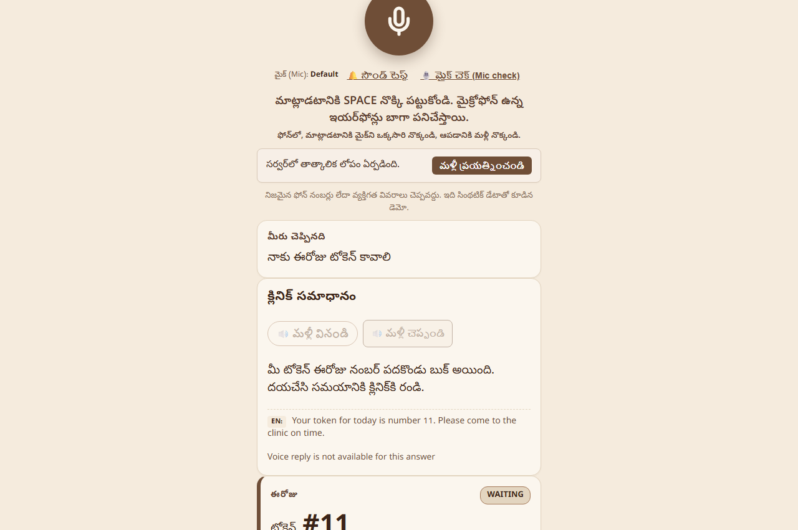
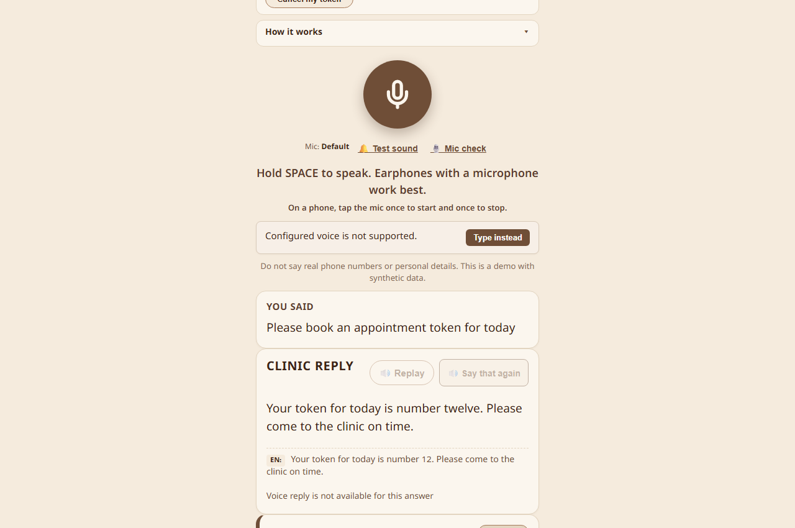
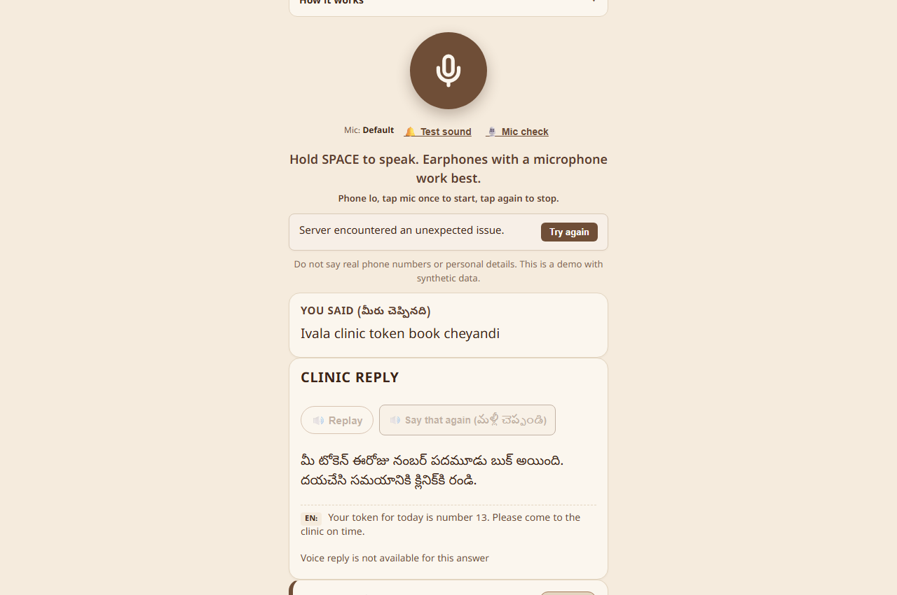
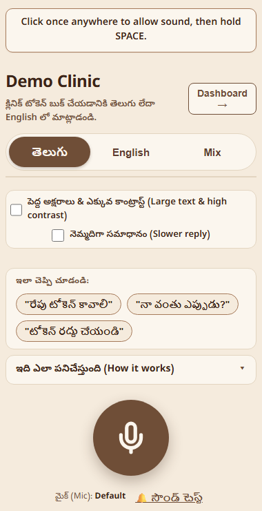
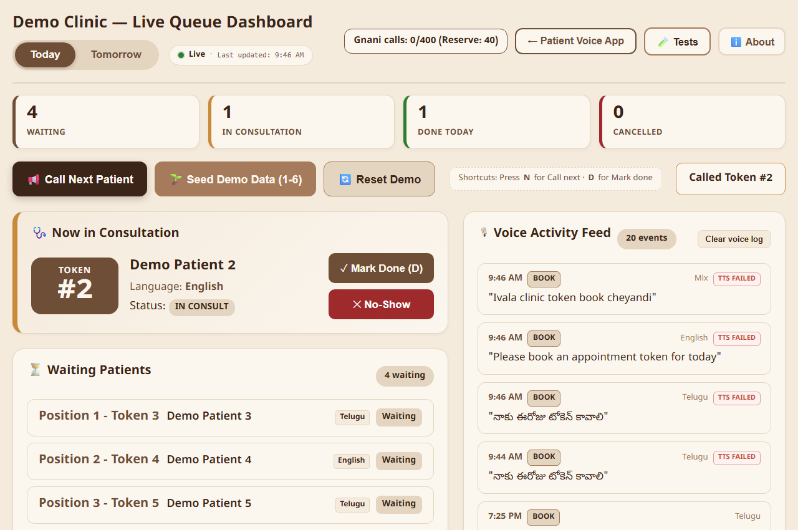
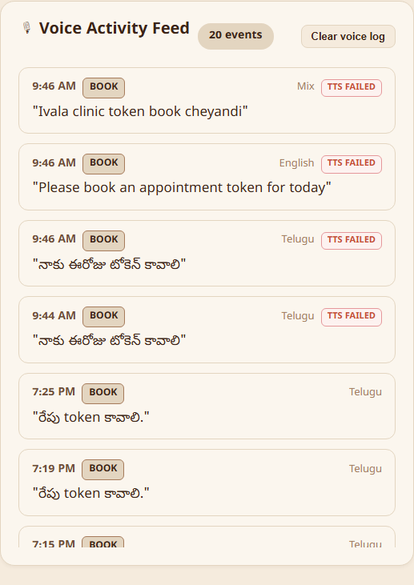
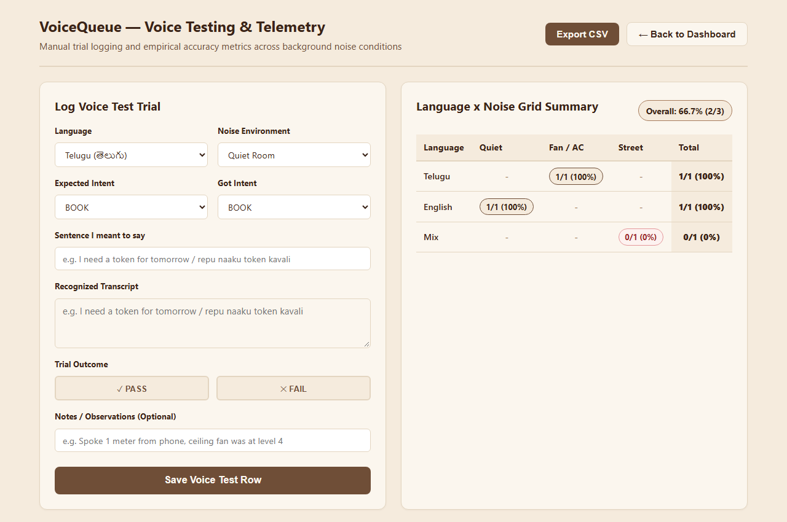
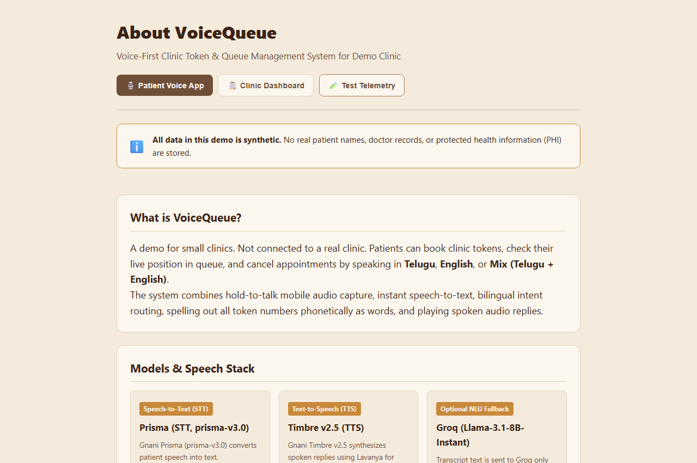
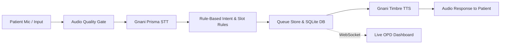

# VoiceQueue (gnani.ai)

Voice-first outpatient clinic queue and appointment booking assistant supporting Telugu, English, and code-mixed speech.
Built solo by D Steven Son for the Great Indian AI Internship Challenge 2026 (Gnani AI).

## Demo Video
[DEMO VIDEO LINK - add after posting]

## Problem & Target Users
In Indian outpatient clinics, long physical queues and digital kiosks with complex text interfaces create severe barriers for elderly, rural, and non-English-speaking patients. Clinic receptionists are simultaneously overwhelmed by repetitive booking, token tracking, and queue status inquiries.

**Target Users:**
- **Patients**: Walk-in and remote clinic visitors speaking Telugu, Indian English, or code-mixed Telugu-English who need an effortless, spoken way to book visits or check wait times.
- **Clinic Receptionists / OPD Staff**: Desk operators needing a live, synchronized queue board with one-click status transitions (call next, in consultation, completed, no-show) and automated audio announcements.

## Features
- **Trilingual Voice Interaction**: Spoken turn-by-turn conversation in Telugu, English, and Code-Mixed mode (`backend/app/services/turn_service.py`, `backend/app/services/intent.py`).
- **Rule-Based Slot Extraction**: Deterministic extraction of patient name, age, department, phone number, and appointment day (`backend/app/services/intent.py`).
- **Audio Quality Gates**: Automated 16kHz mono WAV validation, silence detection, duration checks (0.5s–15s), and RMS volume normalization before calling speech APIs (`backend/app/services/audio.py`).
- **Queue Management Engine**: Token generation, queue depth tracking, estimated wait time calculation, and status updates (`backend/app/services/queue_service.py`).
- **Live Receptionist Dashboard**: Real-time WebSocket synchronization for queue state changes, consultation handling, and emergency tagging (`frontend/src/pages/ClinicDashboard.jsx`).
- **Accessibility & Slow Speech**: Client-side 0.85x audio playback toggle for elderly clarity (`frontend/src/pages/PatientPage.jsx`).
- **Built-in Benchmark & Field Testing Page**: In-app test runner and CSV trial logger for STT/TTS quality analysis (`frontend/src/pages/TestsPage.jsx`).

## Screenshots

| Telugu Patient Booking | English Patient Booking |
| :---: | :---: |
| <br>*Telugu voice/text booking with confirmation card* | <br>*English booking confirmation and token details* |

| Mix Mode Booking | Mobile View (380px) |
| :---: | :---: |
| <br>*Code-mixed Telugu-English conversation* | <br>*Responsive mobile layout* |

| Live Reception Dashboard | Voice Activity Feed |
| :---: | :---: |
| <br>*Live queue dashboard with active consultation* | <br>*Real-time voice event log and latency tracker* |

| Voice Test & Benchmark Suite | Architecture & About Page |
| :---: | :---: |
| <br>*Field testing interface with logged trials* | <br>*System overview, design philosophy, and metrics* |

## How It Works
1. **Speak / Type**: Patient speaks into the microphone (or types a turn).
2. **Audio Preprocessing**: Browser records audio; backend verifies WAV format, sample rate (16kHz mono), silence, and volume.
3. **Speech-to-Text (STT)**: Audio stream is transcribed using Gnani Prisma STT.
4. **Intent & Slot Extraction**: Rule-based regex and keyword scoring identify intent and fill slots (department, name, age, day).
5. **Queue Mutation**: SQLite database allocates the next sequential token and computes estimated wait time.
6. **Text-to-Speech (TTS)**: Response text is converted to spoken audio via Gnani Timbre TTS.
7. **Broadcast**: Live receptionist dashboard updates immediately over WebSockets.



## Gnani Models Used
- **Prisma STT** (`prisma-v3.0`): 16kHz mono speech recognition for Telugu, English, and code-mixed audio.
- **Timbre TTS** (`timbre-v2.5`): Neural speech synthesis using voice `Lavanya` for Telugu/Mix and `Trupti` for English.
- *Note*: Intent recognition, slot extraction, and dialogue management are 100% deterministic rule-based logic. Gnani AI APIs are used strictly for speech recognition and synthesis.

## Tech Stack
- **Backend**: Python 3.11+, FastAPI (>=0.111.0), Uvicorn (>=0.30.1), SQLAlchemy (>=2.0.31), Pydantic (>=2.0.0), WebSockets (>=12.0), HTTPX (>=0.27.0), RapidFuzz (>=3.0.0), FFmpeg (8.1.1).
- **Frontend**: React 18.3.1, Vite 5.4.11, Vitest 2.1.8, Playwright 1.64.1, Lucide React (0.460.0).
- **Database**: SQLite with WAL mode.

## Quick Start

### Prerequisites
- Python 3.11+
- Node.js 20+
- FFmpeg installed and present in system PATH

### 1. Backend Setup
```bash
python -m venv venv
# Windows: venv\Scripts\activate | Linux/macOS: source venv/bin/activate
pip install -r backend/requirements.txt
```

### 2. Frontend Setup
```bash
cd frontend
npm install
cd ..
```

### 3. Environment Configuration
Create a `.env` file in the project root based on `.env.example`:
```ini
GNANI_API_KEY=your_key_here
GNANI_TOKEN=your_token_here
GNANI_API_SECRET=your_secret_here
GNANI_PRISMA_URL=https://asr.gnani.ai/
GNANI_TIMBRE_URL=https://tts.gnani.ai/
DATABASE_URL=sqlite:///./voicequeue.db
DEMO_LIMITS=on
GNANI_DAILY_CAP=400
GNANI_RESERVE=40
```
*Note*: Voice features require a valid Gnani API key and credentials. The app remains fully testable via text-typing mode even without voice credentials. For local testing without rate limits, set `DEMO_LIMITS=off`.

### 4. Run the Application
Start the backend server:
```bash
uvicorn backend.app.main:app --reload --port 8000
```
Start the frontend development server:
```bash
cd frontend
npm run dev
```
Open `http://localhost:5173` in your browser.

## Testing and Results

### (a) Automated Test Suites
- **Backend**: 31 pytest files covering CRUD operations, audio quality gates, cancellation flow, rate limits, WAV repair, phonetic number conversions, and PII masking (`docs/07_TESTING_AND_RESULTS.md`).
- **Frontend**: 36 Vitest unit tests across component suites (`App`, `ClinicDashboard`, `AboutPage`) and Playwright E2E browser tests (`dashboard.spec.js`, `patient_voice.spec.js`, `screenshots_and_a11y.spec.js`).

### (b) Text-Only Intent Tests (no audio)
- **Canonical Benchmark** (`docs/test_phrases.csv`): 45/45 passed (100.0%).
- **Extended Test Matrix** (`docs/test_run/T3_intent_matrix.md`): 86/92 passed (93.47%).
- *Observed Failures*: Inflected Telugu dative day forms (`repatiki`, `రేపటికి` missing day slot), standalone question particles (`entha` triggering false status), and out-of-scope slot noise words.

### (c) Real Voice Trials (from Tests Page CSV)
Field test trials logged in the Tests page database:

| Noise Level | Telugu | English | Mix |
| :--- | :---: | :---: | :---: |
| **Quiet** | NOT MEASURED | 1/1 (100.0%) | NOT MEASURED |
| **Fan Noise** | 1/1 (100.0%) | NOT MEASURED | NOT MEASURED |
| **Street Noise** | NOT MEASURED | NOT MEASURED | 0/1 (0.0%) |
| **Total Measured** | **1/1 (100.0%)** | **1/1 (100.0%)** | **0/1 (0.0%)** |

*Overall real voice field accuracy*: 2/3 (66.66%). The Mix street noise trial failed due to heavy background noise truncating STT transcription. All unlisted noise-language combinations are marked NOT MEASURED.

## Limitations
- **6 Supported Intents**: Handles `BOOK`, `STATUS`, `CANCEL`, `YES`, `NO`, and `UNKNOWN`. Unhandled queries fall back to receptionist escalation.
- **Rule-Based NLU**: Lacks LLM contextual generalization; complex Telugu inflections (such as dative forms) or free-form multi-intent sentences can fail slot filling.
- **Languages**: Telugu, Indian English, and Mix only. Mix is the least tested and most sensitive to background noise.
- **Client-Side Slow Audio**: The 0.85x slower speech feature is applied via client-side HTML5/Web Audio playback rate, not natively inside Gnani Timbre TTS requests.
- **Demo Limits**: Enforces daily call caps (`GNANI_DAILY_CAP=400`) and reserve thresholds to prevent credit exhaustion.
- **Synthetic Data & Local Scope**: Uses local SQLite storage and synthetic patient profiles; not deployed to live clinical infrastructure.

## Synthetic Data & Privacy
- **Synthetic Data Only**: All patient records, phone numbers, and consultation tokens shown across screenshots, logs, and test runs are synthetically generated demo data. No real patient data was used.
- **Privacy Protection**: Phone numbers are automatically masked (`XXXXXX1234`) in stored logs, UI views, and exports. In-memory audio buffers are ephemeral and discarded after processing.

## Project Structure & Documentation
```text
VoiceQueue/
├── backend/                # FastAPI application, services, and tests
│   ├── app/                # Main app, routes, models, db, and audio/NLU services
│   └── tests/              # 31 Pytest test files
├── frontend/               # Vite + React single-page application
│   └── src/                # Pages (Patient, Dashboard, Tests, About) and components
├── docs/                   # Architectural specifications and test reports
│   ├── 01_ARCHITECTURE.md
│   ├── 07_TESTING_AND_RESULTS.md
│   ├── 08_SETUP_AND_MAINTENANCE.md
│   └── test_run/12_TEST_RUN_REPORT.md
└── README.md
```
