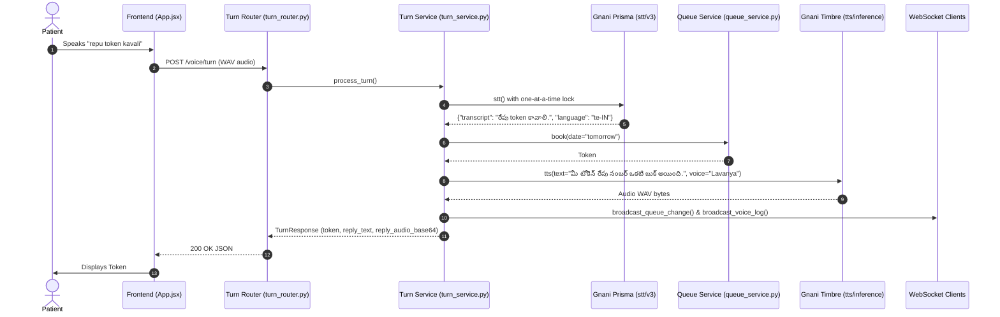
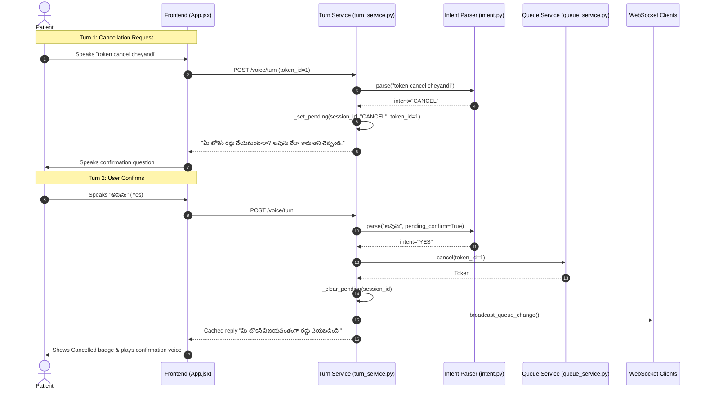

# Application Execution Flows — VoiceQueue

This document traces step-by-step application execution flows using the real functions and components in the VoiceQueue codebase.

---

## (a) Book by Voice Flow

### Step-by-Step Execution:
1. **Audio Capture**: Patient presses and holds the mic button in `frontend/src/App.jsx`. `startAudioRecording()` in `frontend/src/audioCapture.js` captures PCM 16kHz audio from the browser microphone.
2. **Turn Submission**: Releasing the button triggers `stopAudioRecording()`, which creates an audio Blob and invokes `handleTurnSubmit()`.
3. **API Dispatch**: `App.jsx` issues a multipart `POST /voice/turn` request carrying the audio file, selected language (`te`, `en`, or `mix`), and `session_id`.
4. **Endpoint Entry**: In `backend/app/routers/turn_router.py`, `voice_turn()` validates upload size (< 10 MB) and calls `credit_protection.can_make_stt_call()`.
5. **WAV Repair & Transcoding**: `turn_service.process_turn()` calls:
   - `audio.repair_wav_header()` to ensure valid RIFF chunk headers.
   - `audio.convert_to_pcm16_wav()` via FFmpeg to enforce 16kHz mono PCM.
   - `audio.validate_wav()` to verify audio duration and non-silence energy.
6. **Speech-to-Text**: `gnani.stt()` acquires `_gnani_lock` and calls `POST https://api.vachana.ai/stt/v3` (Prisma v3.0). It returns the clean transcript and detected language.
7. **Privacy Masking**: `privacy.mask_pii()` strips Indian phone numbers and personal names.
8. **Intent Routing**: `intent.parse()` matches keywords with RapidFuzz scoring. Returns `intent="BOOK"` and extracted `day` (`"today"` or `"tomorrow"`).
9. **Queue Booking**: `queue_service.book()` allocates the next sequential integer token number for that day in `voicequeue.db`.
10. **Phonetic Conversion & Reply**:
    - `number_words.to_words()` converts the integer token number to phonetic words (`ఒకటి`, `రెండు`, `one`, `two`).
    - `replies.booking_confirmed()` constructs the confirmed reply string.
11. **Text-to-Speech**: `turn_service.synthesize_reply_audio()` calls `gnani.tts()` (Timbre v2.5 with `Lavanya` for Telugu or `Trupti` for English) and returns 16kHz WAV bytes.
12. **Logging & Real-Time Broadcast**:
    - `VoiceLog` record is written to the database.
    - `broadcast.broadcast_queue_change()` and `broadcast.broadcast_voice_log()` push live events over WebSocket `/ws`.
13. **Client Playback**: `App.jsx` receives `TurnResponse`, updates the on-screen active token card, and calls `playBase64Audio()` to speak the response through the patient's speaker.

### Sequence Diagram:

---

## (b) Status Inquiry Flow

1. Patient speaks "What is my token status?" or "నా టోకెన్ స్టేటస్".
2. `App.jsx` submits audio to `POST /voice/turn` with `token_id` of their active token.
3. `gnani.stt()` transcribes the inquiry.
4. `intent.parse()` classifies intent as `STATUS`.
5. `queue_service.position(db, token_id)` calculates how many waiting tokens have smaller numbers for that date.
6. `replies.status_reply()` builds the status sentence containing the patient's token number and queue count ahead.
7. `turn_service.synthesize_reply_audio()` generates TTS audio (or checks cache).
8. `App.jsx` updates queue position on the patient's screen and speaks the status aloud.

---

## (c) Cancel with Confirmation Flow

### Step-by-Step Execution:
1. **Cancellation Request**: Patient speaks "token cancel cheyandi" (or clicks Cancel).
2. **Intent Parsing**: `intent.parse()` detects `CANCEL`.
3. **Pending Confirmation Registration**:
   - `turn_service._set_pending(session_id, "CANCEL", token_id)` stores pending state with a 60-second timestamp.
   - `replies.cancel_prompt()` generates: *"Are you sure you want to cancel token number X? Say yes or no."* (or Telugu equivalent).
4. **Assistant Prompt**: The assistant speaks the confirmation prompt. The patient card enters `confirm-cancel` state.
5. **Confirmation Turn**:
   - Patient speaks "Yes" / "అవును" within 60 seconds.
   - `turn_service._get_pending(session_id)` retrieves the pending cancellation.
   - `intent.parse(text, pending_confirm=True)` evaluates confirmation:
     - If **`YES`**: `queue_service.cancel()` sets token status to `cancelled`. `_clear_pending()` purges pending state. `replies.cancel_confirmed()` serves pre-cached audio (`cancelled_te.wav` / `cancelled_en.wav`). `broadcast_queue_change()` notifies all dashboards.
     - If **`NO`**: `_clear_pending()` aborts cancellation. `replies.cancel_aborted()` speaks that booking remains active.
     - If **Timeout (> 60s)**: Pending state expires; assistant asks patient to state their request again.

### Sequence Diagram:

---

## (d) Day Not Said Flow (Follow-up Question)

1. **Underspecified Request**: Patient speaks *"నాకు ఒక టోకెన్ కావాలి"* or *"I need a token"* without mentioning "today" or "tomorrow".
2. **Intent Parsing**: `intent.parse()` detects `BOOK`, but `_extract_day()` returns `day=None`.
3. **No-Assumption Guard**: `turn_service.process_turn()` detects `day is None`. Instead of guessing or assuming tomorrow, it triggers the clarification branch.
4. **Bilingual Question**:
   - `replies.ask_day(template_lang)` retrieves pre-synthesized audio:
     - Telugu: *"ఈరోజా లేదా రేపా?"* (`backend/cache/audio/ask_day_te.wav`)
     - English: *"Today or tomorrow?"* (`backend/cache/audio/ask_day_en.wav`)
5. **Client Waiting State**: Frontend displays *"Today or tomorrow?"*, plays the audio, and leaves token unbooked.
6. **Follow-Up Turn**: Patient responds *"రేపు"* (Tomorrow) or *"Today"*. `intent.parse()` resolves the day slot and proceeds with booking.

---

## (e) Typed Fallback Flow

1. Patient clicks *"టైప్ చేయడానికి బదులుగా టైప్ చేయండి"* (Type instead) or has mic access disabled.
2. Patient types text into the text box and presses Send.
3. `frontend/src/App.jsx` dispatches `POST /text/turn` with `{ text, language, session_id, token_id }`.
4. In `backend/app/routers/turn_router.py`, `text_turn()` executes.
5. Bypasses audio decoding and STT steps, routing directly to `turn_service.process_turn()`.
6. Checks queue and parses intent identically to voice turns.
7. Generates response text. Audio is served from cache or generated if credits allow.
8. Patient receives on-screen text immediately; they can tap *"🔊 Replay"* to listen to the reply.

---

## (f) Gnani Failure & Error Handling Flow

1. **Failure Trigger**: An outbound call to Gnani STT or TTS encounters an issue (e.g., HTTP 401 bad key, 402 out of credits, 429 rate limit, 500 error, or socket timeout).
2. **Retry Guard**: `gnani._execute_with_lock_and_retry()` pauses for 1.0s and retries network/5xx/429 errors once.
3. **Exception Translation**: If failure persists, `gnani.py` raises a specific typed exception (`GnaniAuthError`, `GnaniNoCreditsError`, `GnaniRateLimitError`, `TTSInvalidAudioError`).
4. **Metric Recording**: `monitoring.record_error(error_code)` increments the structured error counter in the database.
5. **Sanitization**: `sanitize_gnani_error()` scrubs any API keys or tokens from internal error text before logging.
6. **Localized User Response**:
   - `error_catalog.py` looks up the friendly user-facing translation in the patient's language.
   - For credit depletion: *"Voice demo limit reached for now. Please watch the demo video or try typing."*
   - For audio corruption: *"Audio could not be synthesized. Please try again."*
7. **Graceful UI Rendering**: App sets `error_code` in `TurnResponse`, displays the friendly error banner, and unlocks typed input so the patient is never stranded.

---

## (g) Dashboard Queue Actions Flow

Managed in `frontend/src/ClinicDashboard.jsx` and `backend/app/routers/queue_router.py`:

1. **Call Next Patient**:
   - Clinic staff clicks *"Call Next"*.
   - Frontend sends `POST /tokens/call-next`.
   - `queue_router.call_next_token()` invokes `queue_service.call_next(db)`.
   - Previous `called` token transitions to `done`; next `waiting` token transitions to `called`.
   - `broadcast.broadcast_token_called()` triggers audio chime and visual alert banner on patient screens.
   - `broadcast.broadcast_queue_change()` refreshes all dashboard views.
2. **Mark Done / No-Show**:
   - Staff clicks *"Done"* or *"No-Show"* on a patient row.
   - Frontend sends `POST /tokens/{id}/status` with `{"status": "done"}` or `{"status": "no_show"}`.
   - Database record updates; `broadcast.broadcast_queue_change()` syncs all clients.
3. **Seed Demo Tokens**:
   - Staff clicks *"Seed Demo Tokens"*.
   - Frontend sends `POST /demo/seed` (rate-limited; checks `X-Owner-Key` in production).
   - `queue_service.auto_seed_if_empty(db, count=4)` creates `Demo Patient 1–4`.
   - `broadcast.broadcast_queue_change()` populates the dashboard queue grid.
4. **Reset Demo**:
   - Staff clicks *"Reset Demo"*.
   - Frontend sends `POST /demo/reset`.
   - `queue_service.reset_all(db)` deletes all active queue tokens and re-initializes sequence counters.
   - `broadcast.broadcast_demo_reset()` alerts patient screens to clear stale token polling.
