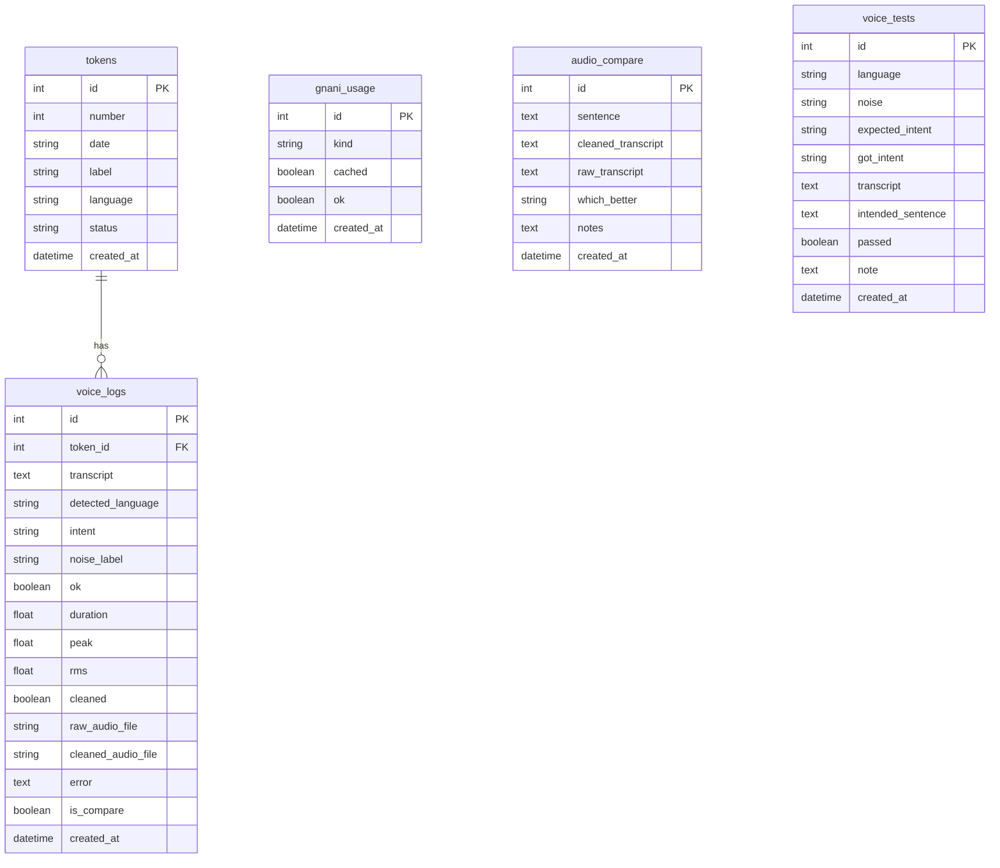

# VoiceQueue API and Database Schema

**Document**: `05_API_AND_SCHEMA.md`  
**Application**: VoiceQueue (`gnani.ai`)  
**Backend Framework**: FastAPI (v0.111.0+) / Uvicorn  
**Database**: SQLite (`sqlite:///./voicequeue.db`) via SQLAlchemy ORM  

---

## 1. Backend REST Endpoints

### 1.1 System & Health Endpoints
Handled in [`backend/app/main.py`](file:///e:/VoiceQueue(gnani.ai)/backend/app/main.py).

#### `GET /health`
* **Handler**: [`get_health()`](file:///e:/VoiceQueue(gnani.ai)/backend/app/main.py#L108-L165) in [`backend/app/main.py`](file:///e:/VoiceQueue(gnani.ai)/backend/app/main.py)
* **Description**: Returns overall system configuration, Gnani STT/TTS availability, FFmpeg status, Telugu voice verification, uptime, and daily credit call counts.
* **Request**: None (no headers or query parameters required).
* **Response**: `200 OK` (`HealthResponse`)
  ```json
  {
    "status": "ok",
    "gnani_configured": true,
    "groq_configured": false,
    "ffmpeg_found": true,
    "voices_configured": true,
    "voices_valid": true,
    "voice_te_status": "ok",
    "voice_en_status": "ok",
    "tts_model": "timbre-v2.5",
    "voice_te_lang": "te-IN",
    "voice_en_lang": "en-IN",
    "voice_te_voice": "Lavanya",
    "voice_en_voice": "Trupti",
    "voice_error_reason": null,
    "invalid_voice": null,
    "bad_voice": null,
    "clinic_name": "Demo Clinic",
    "debug_save_audio": false,
    "telugu_reviewed": true,
    "daily_calls_used": 0,
    "daily_cap": 150,
    "cap": 150,
    "uptime_seconds": 124.5,
    "uptime": "2m 4s"
  }
  ```
* **Errors**: Standard 500 if unexpected internal error occurs.

#### `GET /telugu-review-status`
* **Handler**: [`telugu_review_status_endpoint()`](file:///e:/VoiceQueue(gnani.ai)/backend/app/main.py#L177-L180) in [`backend/app/main.py`](file:///e:/VoiceQueue(gnani.ai)/backend/app/main.py)
* **Description**: Returns native speaker review audit state for canonical Telugu UI and voice response strings.
* **Request**: None.
* **Response**: `200 OK` (JSON dict)
  ```json
  {
    "reviewed_by_native_speaker": true,
    "reviewer": "VoiceQueue Validation Suite",
    "total_canonical_keys": 12,
    "approved_keys": 12
  }
  ```
* **Errors**: None.

---

### 1.2 Queue & Token Endpoints
Handled in [`backend/app/routers/queue_router.py`](file:///e:/VoiceQueue(gnani.ai)/backend/app/routers/queue_router.py).

#### `POST /tokens`
* **Handler**: [`book_token()`](file:///e:/VoiceQueue(gnani.ai)/backend/app/routers/queue_router.py#L66-L75)
* **Description**: Books a new token for today or tomorrow. Broadcasts `queue_changed` WebSocket notification.
* **Request**: JSON body (`TokenCreate`)
  ```json
  {
    "day": "today",
    "language": "te-IN"
  }
  ```
* **Response**: `201 Created` (`TokenResponse`)
  ```json
  {
    "id": 1,
    "number": 1,
    "date": "2026-11-07",
    "label": "Token #1 (Today)",
    "language": "te-IN",
    "status": "waiting",
    "created_at": "2026-11-07T07:42:00Z",
    "ahead_count": 0
  }
  ```
* **Errors**:
  * `400 Bad Request`: `Invalid day parameter` or invalid date string.

#### `GET /tokens/{token_id}`
* **Handler**: [`get_token()`](file:///e:/VoiceQueue(gnani.ai)/backend/app/routers/queue_router.py#L77-L84)
* **Description**: Retrieves token details and real-time waiting position ahead in queue.
* **Request**: Path parameter `token_id` (integer).
* **Response**: `200 OK` (`TokenResponse`)
* **Errors**:
  * `404 Not Found`: `Token not found.`

#### `GET /tokens/{token_id}/call-alert`
* **Handler**: [`get_token_call_alert()`](file:///e:/VoiceQueue(gnani.ai)/backend/app/routers/queue_router.py#L86-L104)
* **Description**: Returns chime/spoken call alert message and optional audio for a called token (honors `ALERT_VOICE` configuration).
* **Request**:
  * Path parameter `token_id` (integer)
  * Query parameter `lang` (string, default `"te-IN"`)
* **Response**: `200 OK` (`CallAlertResponse`)
  ```json
  {
    "alert_voice": false,
    "audio_base64": null,
    "source": "none",
    "message": "టోకెన్ 1 దయచేసి కన్సల్టేషన్ గదికి రండి",
    "token_id": 1,
    "number": 1
  }
  ```
* **Errors**:
  * `404 Not Found`: `Token not found.`

#### `POST /tokens/{token_id}/cancel`
* **Handler**: [`cancel_token()`](file:///e:/VoiceQueue(gnani.ai)/backend/app/routers/queue_router.py#L106-L118)
* **Description**: Cancels a waiting token. Completed (`done`) tokens cannot be cancelled. Broadcasts `queue_changed`.
* **Request**: Path parameter `token_id` (integer).
* **Response**: `200 OK` (`TokenResponse`)
* **Errors**:
  * `404 Not Found`: `Token not found.`
  * `400 Bad Request`: `Cannot cancel a token that is already done.`

#### `GET /queue`
* **Handler**: [`get_queue()`](file:///e:/VoiceQueue(gnani.ai)/backend/app/routers/queue_router.py#L120-L139)
* **Description**: Retrieves full patient list, waiting count, and currently consulting token for a target day (`today`, `tomorrow`, or `YYYY-MM-DD`).
* **Request**: Query parameter `day` (string, default `"today"`).
* **Response**: `200 OK` (`QueueResponse`)
  ```json
  {
    "date": "2026-11-07",
    "total_tokens": 4,
    "waiting_count": 3,
    "current_in_consult": {
      "id": 1,
      "number": 1,
      "date": "2026-11-07",
      "label": "Token #1 (Today)",
      "language": "te-IN",
      "status": "in_consult",
      "created_at": "2026-11-07T07:42:00Z",
      "ahead_count": 0
    },
    "tokens": [...]
  }
  ```
* **Errors**:
  * `400 Bad Request`: Invalid day format.

#### `POST /queue/next`
* **Handler**: [`call_next_token()`](file:///e:/VoiceQueue(gnani.ai)/backend/app/routers/queue_router.py#L141-L154)
* **Description**: Advances queue: marks any currently consulting token as done and transitions next waiting token to `in_consult`. Broadcasts `queue_changed` and `token_called`.
* **Request**: Query parameter `day` (string, default `"today"`).
* **Response**: `200 OK` (`TokenResponse` or `null` if queue empty)
* **Errors**:
  * `400 Bad Request`: Invalid day format.

#### `POST /queue/{token_id}/done`
* **Handler**: [`mark_token_done()`](file:///e:/VoiceQueue(gnani.ai)/backend/app/routers/queue_router.py#L156-L168)
* **Description**: Marks specific token consultation as completed (`done`). Broadcasts `queue_changed`.
* **Request**: Path parameter `token_id` (integer).
* **Response**: `200 OK` (`TokenResponse`)
* **Errors**:
  * `404 Not Found`: `Token not found.`
  * `400 Bad Request`: Invalid transition.

#### `POST /queue/{token_id}/no-show`
* **Handler**: [`mark_token_no_show()`](file:///e:/VoiceQueue(gnani.ai)/backend/app/routers/queue_router.py#L170-L182)
* **Description**: Marks specific token as patient no-show (`no_show`). Broadcasts `queue_changed`.
* **Request**: Path parameter `token_id` (integer).
* **Response**: `200 OK` (`TokenResponse`)
* **Errors**:
  * `404 Not Found`: `Token not found.`

#### `POST /demo/reset`
* **Handler**: [`reset_demo_data()`](file:///e:/VoiceQueue(gnani.ai)/backend/app/routers/queue_router.py#L184-L193)
* **Description**: Resets demo queue tokens and interaction logs for a fresh presentation. Rate-limited on deployed builds. Broadcasts `queue_changed` and `demo_reset`.
* **Request**: Optional Header `x-owner-key`.
* **Response**: `200 OK` (`MessageResponse`)
  ```json
  {
    "message": "Demo queue reset successfully."
  }
  ```
* **Errors**:
  * `429 Too Many Requests`: Rate limit exceeded (more than 5 reset calls in 60s without owner key).

#### `POST /demo/seed`
* **Handler**: [`seed_demo_data()`](file:///e:/VoiceQueue(gnani.ai)/backend/app/routers/queue_router.py#L195-L211)
* **Description**: Injects synthetic patient tokens into the queue (default 4-6 tokens). Broadcasts `queue_changed`.
* **Request**:
  * Query parameters: `day` (default `"today"`), `count` (default `6`)
  * Optional Header: `x-owner-key`
* **Response**: `200 OK` (`List[TokenResponse]`)
* **Errors**:
  * `429 Too Many Requests`: Reset rate limit exceeded.

---

### 1.3 Voice & Text Interaction Turns
Handled in [`backend/app/routers/turn_router.py`](file:///e:/VoiceQueue(gnani.ai)/backend/app/routers/turn_router.py).

#### `POST /voice/turn`
* **Handler**: [`voice_turn()`](file:///e:/VoiceQueue(gnani.ai)/backend/app/routers/turn_router.py#L42-L458)
* **Description**: Core multi-stage voice processing:
  1. Credit protection & IP/session limit validation.
  2. Audio conversion (FFmpeg to 16 kHz mono WAV) & acoustic cleaning.
  3. Quality gates (duration, peak, silence check).
  4. Gnani Prisma STT transcription (under concurrency lock).
  5. Deterministic intent parsing & queue state mutation.
  6. Reply audio synthesis (pre-rendered WAV cache or Gnani Timbre TTS).
  7. Audit telemetry logging & WebSocket broadcast.
* **Request**: `multipart/form-data`
  * `audio`: File upload (`wav`, `webm`, `mp4`, `ogg`)
  * `language`: Form string (`"te"`, `"en"`, or `"mix"`, default `"te"`)
  * `session_id`: Form string (client UUID)
  * `token_id`: Form integer (optional active token ID)
  * `noise_label`: Form string (optional: `"quiet"`, `"fan"`, `"street"`)
  * `clean`: Form boolean (default `true`)
  * `compare`: Form boolean (default `false`)
* **Response**: `200 OK` (`TurnResponse`)
  ```json
  {
    "transcript": "నాకు రేపటికి టోకెన్ కావాలి",
    "detected_language": "Telugu",
    "reply_language": "te-IN",
    "intent": "BOOK",
    "reply_text": "మీ టోకెన్ నంబర్ 5. రేపటి కోసం బుక్ చేసాము.",
    "reply_audio_base64": "<base64_encoded_wav_bytes>",
    "token": {
      "id": 5,
      "number": 5,
      "date": "2026-11-08",
      "label": "Token #5 (Tomorrow)",
      "language": "te-IN",
      "status": "waiting",
      "created_at": "2026-11-07T07:44:00Z",
      "ahead_count": 0
    },
    "pending_confirm": false,
    "error": null,
    "error_code": null,
    "audio_stats": {"duration": 1.9, "peak": 0.81, "rms": 0.14},
    "audio_source": "timbre",
    "audio_duration_seconds": 2.4,
    "audio_bytes": 76844,
    "audio_error": null,
    "stage_times_ms": {
      "convert": 42.1,
      "clean": 28.5,
      "quality_gates": 0.4,
      "stt": 810.2,
      "intent": 1.1,
      "queue_action": 3.8,
      "reply_choice": 0.1,
      "tts_or_cache": 920.4,
      "response_build": 1.2,
      "total": 1807.8
    },
    "limit_reason": null,
    "limit_counts": null,
    "demo_video_url": null,
    "english_translation": "Your token number is 5. Booked for tomorrow.",
    "voice_error_reason": null
  }
  ```
* **Errors Handled**:
  * Returns structured `TurnResponse` with `error_code` (e.g., `mic_denied`, `too_short`, `too_quiet`, `no_speech`, `unclear_speech`, `gnani_error`, `credit_limit`, `demo_limit`, `compare_limit`). Never crashes or leaks stack traces.

#### `POST /text/turn`
* **Handler**: [`text_turn()`](file:///e:/VoiceQueue(gnani.ai)/backend/app/routers/turn_router.py#L504-L533)
* **Description**: Typed fallback endpoint. Runs identical intent resolution and queue actions as `/voice/turn`. Bypasses STT and serves audio from cached phrases if live limits are reached.
* **Request**: JSON body (`TextTurnRequest`)
  ```json
  {
    "text": "what is my token status",
    "language": "en",
    "session_id": "client-uuid-1234",
    "token_id": 1
  }
  ```
* **Response**: `200 OK` (`TurnResponse`)
* **Errors**: Standard validation errors (HTTP 422 for malformed body).

#### `POST /voice/retry-audio`
* **Handler**: [`retry_audio()`](file:///e:/VoiceQueue(gnani.ai)/backend/app/routers/turn_router.py#L535-L565)
* **Description**: Retries speech synthesis for an existing turn reply without re-running STT or intent parsing.
* **Request**: JSON body (`RetryAudioRequest`)
  ```json
  {
    "text": "మీ టోకెన్ నంబర్ 1. డాక్టర్ గారు చూస్తున్నారు.",
    "language": "te"
  }
  ```
* **Response**: `200 OK` (`RetryAudioResponse`)
  ```json
  {
    "reply_audio_base64": "<base64_audio>",
    "audio_source": "timbre",
    "audio_duration_seconds": 2.1,
    "audio_bytes": 67244,
    "audio_error": null,
    "stage_times_ms": null,
    "limit_reason": null,
    "limit_counts": null,
    "demo_video_url": null,
    "english_translation": null,
    "voice_error_reason": null
  }
  ```
* **Errors**: None. Returns error fields gracefully inside response schema.

#### `GET /voice-logs`
* **Handler**: [`get_voice_logs()`](file:///e:/VoiceQueue(gnani.ai)/backend/app/routers/turn_router.py#L579-L610)
* **Description**: Returns recent voice turns with matched token numbers and timestamps in IST.
* **Request**: Query parameter `limit` (int, default `20`, min `1`, max `100`).
* **Response**: `200 OK` (`List[VoiceLogItem]`)
  ```json
  [
    {
      "id": 12,
      "time": "01:15 PM",
      "transcript": "నా టోకెన్ క్యాన్సిల్ చేయండి",
      "detected_language": "Telugu",
      "intent": "CANCEL",
      "token_number": 3,
      "ok": true,
      "error": null,
      "error_code": null
    }
  ]
  ```

#### `POST /voice-logs/clear`
* **Handler**: [`clear_voice_logs()`](file:///e:/VoiceQueue(gnani.ai)/backend/app/routers/turn_router.py#L612-L620)
* **Description**: Clears all records in `voice_logs` table without altering patient tokens. Broadcasts `voice_log` event.
* **Request**: None.
* **Response**: `200 OK` (`MessageResponse`)

#### `GET /usage`
* **Handler**: [`get_usage()`](file:///e:/VoiceQueue(gnani.ai)/backend/app/routers/turn_router.py#L622-L684)
* **Description**: Returns real vs cached Gnani call usage counts and credit consumption.
* **Request**: None.
* **Response**: `200 OK` (`UsageResponse`)
  ```json
  {
    "real_calls_today": 14,
    "real_calls_total": 36,
    "limit": 150,
    "reserve": 40,
    "cached_calls": 22,
    "stt_calls": 18,
    "tts_calls": 18,
    "estimated_credits_used": null
  }
  ```

---

### 1.4 Audio Lab & Audio Compare Endpoints
Handled in [`backend/app/routers/turn_router.py`](file:///e:/VoiceQueue(gnani.ai)/backend/app/routers/turn_router.py).

#### `GET /debug-audio/{filename}`
* **Handler**: [`get_debug_audio()`](file:///e:/VoiceQueue(gnani.ai)/backend/app/routers/turn_router.py#L688-L705)
* **Description**: Streams raw or cleaned audio recording files when `DEBUG_SAVE_AUDIO=true`.
* **Request**: Path parameter `filename` (string, e.g. `raw_turn_12.wav`).
* **Response**: File stream (`audio/wav`, `audio/webm`, `audio/ogg`, or `audio/mp4`).
* **Errors**: `404 Not Found` if file does not exist.

#### `POST /debug-audio/clear`
* **Handler**: [`clear_debug_audio()`](file:///e:/VoiceQueue(gnani.ai)/backend/app/routers/turn_router.py#L707-L712)
* **Description**: Deletes all recorded debug audio files on disk.
* **Response**: `200 OK` (`MessageResponse`)

#### `GET /audio-lab/turns`
* **Handler**: [`get_audio_lab_turns()`](file:///e:/VoiceQueue(gnani.ai)/backend/app/routers/turn_router.py#L714-L758)
* **Description**: Returns the last 10 voice turns with duration, peak amplitude, RMS energy, cleaning flag, and audio download URLs.
* **Response**: `200 OK` (`List[AudioLabTurnItem]`)

#### `GET /audio-compare/status`
* **Handler**: [`get_audio_compare_status()`](file:///e:/VoiceQueue(gnani.ai)/backend/app/routers/turn_router.py#L769-L779)
* **Description**: Returns compare mode call count, quota limit (`COMPARE_MAX_CALLS`, default 20), and limit flag.
* **Response**: `200 OK` (`{"used": 0, "max": 20, "limit_reached": false}`)

#### `GET /audio-compare`
* **Handler**: [`get_audio_comparisons()`](file:///e:/VoiceQueue(gnani.ai)/backend/app/routers/turn_router.py#L781-L789)
* **Description**: Retrieves all recorded A/B trials comparing raw vs cleaned audio.
* **Response**: `200 OK` (`List[AudioCompareResponse]`)

#### `POST /audio-compare`
* **Handler**: [`create_audio_comparison()`](file:///e:/VoiceQueue(gnani.ai)/backend/app/routers/turn_router.py#L791-L808)
* **Description**: Saves an A/B trial comparing raw audio STT transcript against cleaned audio STT transcript.
* **Request**: JSON body (`AudioCompareCreate`)
  ```json
  {
    "sentence": "నాకు రేపటికి టోకెన్ కావాలి",
    "cleaned_transcript": "నాకు రేపటికి టోకెన్ కావాలి",
    "raw_transcript": "నాకు రేపటికి టోకెన్",
    "which_better": "cleaned",
    "notes": "fan noise in background suppressed by highpass filter"
  }
  ```
* **Response**: `200 OK` (`AudioCompareResponse`)

#### `GET /audio-compare/export` and `GET /audio-compare/export.csv`
* **Handler**: [`export_audio_comparisons_csv()`](file:///e:/VoiceQueue(gnani.ai)/backend/app/routers/turn_router.py#L810-L845)
* **Description**: Downloads all records from `audio_compare` table as a UTF-8 CSV attachment.
* **Response**: `200 OK` (`text/csv`, `attachment; filename=audio_compare.csv`).

---

### 1.5 Developer & Diagnostics Endpoints
Handled in [`backend/app/routers/turn_router.py`](file:///e:/VoiceQueue(gnani.ai)/backend/app/routers/turn_router.py) and [`backend/app/main.py`](file:///e:/VoiceQueue(gnani.ai)/backend/app/main.py).

#### `GET /dev/error-counts`
* **Handler**: [`get_dev_error_counts()`](file:///e:/VoiceQueue(gnani.ai)/backend/app/main.py#L167-L175)
* **Description**: Real-time in-memory error counter grouped by error code.
* **Response**: `200 OK` (`{"error_counts": {"too_short": 1}, "total_errors": 1}`)

#### `GET /dev/limits`
* **Handler**: [`dev_limits()`](file:///e:/VoiceQueue(gnani.ai)/backend/app/routers/turn_router.py#L460-L473)
* **Description**: Inspects per-IP and per-session call counters.
* **Errors**: `403 Forbidden` if `DEV_ENDPOINTS=false`.

#### `POST /dev/reset-limits`
* **Handler**: [`dev_reset_limits()`](file:///e:/VoiceQueue(gnani.ai)/backend/app/routers/turn_router.py#L475-L488)
* **Description**: Flushes in-memory IP and session throttling counters.
* **Errors**: `403 Forbidden` if `DEV_ENDPOINTS=false`.

#### `GET /dev/latency`
* **Handler**: [`dev_latency()`](file:///e:/VoiceQueue(gnani.ai)/backend/app/routers/turn_router.py#L490-L502)
* **Description**: Returns p50 and p95 latency breakdowns across all 9 pipeline stages for the last 50 turns.
* **Errors**: `403 Forbidden` if `DEV_ENDPOINTS=false`.

---

### 1.6 Voice Testing Telemetry Endpoints
Handled in [`backend/app/routers/voice_test_router.py`](file:///e:/VoiceQueue(gnani.ai)/backend/app/routers/voice_test_router.py).

#### `POST /voice-tests`
* **Handler**: [`record_voice_test()`](file:///e:/VoiceQueue(gnani.ai)/backend/app/routers/voice_test_router.py#L25-L42)
* **Description**: Saves manual voice testing telemetry record.
* **Request**: JSON body (`VoiceTestCreate`)
* **Response**: `201 Created` (`VoiceTestResponse`)

#### `GET /voice-tests`
* **Handler**: [`list_voice_tests()`](file:///e:/VoiceQueue(gnani.ai)/backend/app/routers/voice_test_router.py#L44-L48)
* **Description**: Retrieves all recorded manual test trials ordered descending by ID.
* **Response**: `200 OK` (`List[VoiceTestResponse]`)

#### `GET /voice-tests/summary`
* **Handler**: [`get_voice_tests_summary()`](file:///e:/VoiceQueue(gnani.ai)/backend/app/routers/voice_test_router.py#L50-L94)
* **Description**: Calculates pass rate metrics grouped by language (`te`, `en`, `mix`) and noise condition (`quiet`, `fan`, `street`).
* **Response**: `200 OK` (`VoiceTestSummary`)

#### `GET /voice-tests/text-summary`
* **Handler**: [`get_text_tests_summary()`](file:///e:/VoiceQueue(gnani.ai)/backend/app/routers/voice_test_router.py#L96-L118)
* **Description**: Executes the 45 test phrases in `docs/test_phrases.csv` dynamically through the intent parser and returns pass count.
* **Response**: `200 OK` (`{"passed": 45, "total": 45}`)

#### `GET /voice-tests/export`
* **Handler**: [`export_voice_tests_csv()`](file:///e:/VoiceQueue(gnani.ai)/backend/app/routers/voice_test_router.py#L120-L160)
* **Description**: Downloads all voice test records as a CSV attachment.
* **Response**: `200 OK` (`text/csv`, `attachment; filename="voice_tests.csv"`).

---

## 2. WebSocket Protocol and Message Formats

### 2.1 Connection Details
* **Endpoint**: `ws://<host>:<port>/ws/queue`
* **Handler**: [`websocket_queue_endpoint()`](file:///e:/VoiceQueue(gnani.ai)/backend/app/main.py#L75-L87) in [`backend/app/main.py`](file:///e:/VoiceQueue(gnani.ai)/backend/app/main.py)
* **Manager**: [`ConnectionManager`](file:///e:/VoiceQueue(gnani.ai)/backend/app/services/connection_manager.py#L8-L35) in [`backend/app/services/connection_manager.py`](file:///e:/VoiceQueue(gnani.ai)/backend/app/services/connection_manager.py)

### 2.2 Client to Server Messages
* Clients may send plain text keep-alive / ping messages (e.g. `"ping"`).

### 2.3 Server to Client Broadcast Events

#### 1. `queue_changed`
Broadcast when tokens are booked, marked done, cancelled, no-show, called next, or seeded.
```json
{
  "type": "queue_changed",
  "date": "2026-11-07"
}
```

#### 2. `token_called`
Broadcast when the clinic staff calls a patient into consultation (`POST /queue/next`).
```json
{
  "type": "token_called",
  "token_id": 4,
  "token_number": 4
}
```

#### 3. `voice_log`
Broadcast whenever a patient completes a voice interaction or when voice logs are cleared.
```json
{
  "type": "voice_log",
  "log": null
}
```
*(Note: If `log` is null, client refetches the latest logs via `GET /voice-logs`)*.

#### 4. `demo_reset`
Broadcast when the demo environment is wiped via `POST /demo/reset`.
```json
{
  "type": "demo_reset"
}
```

---

## 3. Database Schema (SQLAlchemy Models)

All database models inherit from `Base` in [`backend/app/db.py`](file:///e:/VoiceQueue(gnani.ai)/backend/app/db.py) and are defined in [`backend/app/models.py`](file:///e:/VoiceQueue(gnani.ai)/backend/app/models.py).

### 3.1 Table: `tokens`
Stores clinic appointments and patient queue state.

| Column | SQLAlchemy Type | Constraints | Default | Description |
| :--- | :--- | :--- | :--- | :--- |
| `id` | `Integer` | Primary Key, Index, Autoincrement | Auto | Unique token ID |
| `number` | `Integer` | Nullable=False, Index | - | Daily sequential token number (e.g. 1, 2, 3...) |
| `date` | `String(10)` | Nullable=False, Index | - | Appointment date in `YYYY-MM-DD` |
| `label` | `String(50)` | Nullable=False | - | Human label (e.g., `Token #1 (Today)`) |
| `language` | `String(10)` | Nullable=False | `"te-IN"` | Patient preferred language (`te-IN`, `en-IN`, `mix`) |
| `status` | `String(20)` | Nullable=False, Index | `"waiting"` | `waiting`, `in_consult`, `done`, `cancelled`, `no_show` |
| `created_at` | `DateTime` | Nullable=False | `datetime.now(timezone.utc)` | Creation timestamp in UTC |

* **Relationships**:
  * `voice_logs`: One-to-Many with `VoiceLog` (`relationship("VoiceLog", back_populates="token")`).

---

### 3.2 Table: `voice_logs`
Audit and telemetry logging for every patient voice turn.

| Column | SQLAlchemy Type | Constraints | Default | Description |
| :--- | :--- | :--- | :--- | :--- |
| `id` | `Integer` | Primary Key, Index, Autoincrement | Auto | Unique voice log ID |
| `token_id` | `Integer` | Foreign Key (`tokens.id`), Nullable=True | `None` | Matched patient token (if any) |
| `transcript` | `Text` | Nullable=False | - | Gnani STT transcript text |
| `detected_language` | `String(10)` | Nullable=False | - | Detected language (`te`, `en`, `mix`) |
| `intent` | `String(50)` | Nullable=False | - | Parsed intent (`BOOK`, `STATUS`, `CANCEL`, etc.) |
| `noise_label` | `String(50)` | Nullable=True | `None` | Noise condition tag (`quiet`, `fan`, `street`) |
| `ok` | `Boolean` | Nullable=False | `True` | Success status of the turn |
| `duration` | `Float` | Nullable=True | `None` | Audio duration in seconds |
| `peak` | `Float` | Nullable=True | `None` | Peak amplitude (normalized 0.0 to 1.0) |
| `rms` | `Float` | Nullable=True | `None` | RMS energy level |
| `cleaned` | `Boolean` | Nullable=False | `True` | `true` if bandpass/gate filter applied |
| `raw_audio_file` | `String(100)` | Nullable=True | `None` | Filename of saved raw audio clip |
| `cleaned_audio_file` | `String(100)` | Nullable=True | `None` | Filename of saved cleaned audio clip |
| `error` | `Text` | Nullable=True | `None` | Standardized error code or error message |
| `is_compare` | `Boolean` | Nullable=False | `False` | `true` if turn occurred during A/B compare |
| `created_at` | `DateTime` | Nullable=False | `datetime.now(timezone.utc)` | Creation timestamp in UTC |

* **Relationships**:
  * `token`: Many-to-One with `Token` (`relationship("Token", back_populates="voice_logs")`).

---

### 3.3 Table: `gnani_usage`
Tracks real vs cached API calls for budget protection.

| Column | SQLAlchemy Type | Constraints | Default | Description |
| :--- | :--- | :--- | :--- | :--- |
| `id` | `Integer` | Primary Key, Index, Autoincrement | Auto | Unique log ID |
| `kind` | `String(10)` | Nullable=False | - | Model kind: `'stt'` or `'tts'` |
| `cached` | `Boolean` | Nullable=False | `False` | `false` if real Gnani API call; `true` if cached |
| `ok` | `Boolean` | Nullable=False | `True` | Call success flag |
| `created_at` | `DateTime` | Nullable=False | `datetime.now(timezone.utc)` | Timestamp in UTC |

---

### 3.4 Table: `audio_compare`
Manual A/B test trials comparing raw vs cleaned audio.

| Column | SQLAlchemy Type | Constraints | Default | Description |
| :--- | :--- | :--- | :--- | :--- |
| `id` | `Integer` | Primary Key, Index, Autoincrement | Auto | Comparison trial ID |
| `sentence` | `Text` | Nullable=False | - | Target spoken test sentence |
| `cleaned_transcript`| `Text` | Nullable=True | `None` | Transcript returned from cleaned audio |
| `raw_transcript` | `Text` | Nullable=True | `None` | Transcript returned from raw audio |
| `which_better` | `String(50)` | Nullable=True | `None` | `'cleaned'`, `'raw'`, or `'same'` |
| `notes` | `Text` | Nullable=True | `None` | Qualitative acoustic observations |
| `created_at` | `DateTime` | Nullable=False | `datetime.now(timezone.utc)` | Creation timestamp in UTC |

---

### 3.5 Table: `voice_tests`
Automated and manual voice test trial telemetry for accuracy benchmarks.

| Column | SQLAlchemy Type | Constraints | Default | Description |
| :--- | :--- | :--- | :--- | :--- |
| `id` | `Integer` | Primary Key, Index, Autoincrement | Auto | Unique test trial ID |
| `language` | `String(20)` | Nullable=False | - | `'te'`, `'en'`, or `'mix'` |
| `noise` | `String(20)` | Nullable=False | - | `'quiet'`, `'fan'`, or `'street'` |
| `expected_intent` | `String(20)` | Nullable=False | - | Target intent |
| `got_intent` | `String(20)` | Nullable=False | - | Actual parsed intent |
| `transcript` | `Text` | Nullable=False | - | Spoken STT transcript |
| `intended_sentence` | `Text` | Nullable=True | `None` | Target sentence intended by speaker |
| `passed` | `Boolean` | Nullable=False | `True` | True if `expected_intent == got_intent` |
| `note` | `Text` | Nullable=True | `None` | Trial observation or failure reason |
| `created_at` | `DateTime` | Nullable=False | `datetime.now(timezone.utc)` | Test timestamp in UTC |

---

## 4. Entity Relationship Diagram



---

## 5. Pydantic Schemas Reference

Defined in [`backend/app/schemas.py`](file:///e:/VoiceQueue(gnani.ai)/backend/app/schemas.py):

| Schema Name | Purpose | Key Attributes |
| :--- | :--- | :--- |
| `HealthResponse` | System health and configuration payload | `status`, `gnani_configured`, `ffmpeg_found`, `voices_valid`, `voice_te_voice`, `voice_en_voice`, `uptime` |
| `TokenCreate` | Input request for token booking | `day` (`"today"` or `"tomorrow"`), `language` (`"te-IN"`) |
| `TokenResponse` | Token entity with live queue position | `id`, `number`, `date`, `label`, `language`, `status`, `created_at`, `ahead_count` |
| `QueueResponse` | Full queue status for day | `date`, `total_tokens`, `waiting_count`, `current_in_consult`, `tokens` |
| `CallAlertResponse`| Audio and text alert for called patient | `alert_voice`, `audio_base64`, `source`, `message`, `token_id`, `number` |
| `TextTurnRequest` | Typed fallback turn request | `text`, `language`, `session_id`, `token_id` |
| `TurnResponse` | Result of voice or text turn | `transcript`, `detected_language`, `intent`, `reply_text`, `reply_audio_base64`, `token`, `stage_times_ms`, `error_code` |
| `RetryAudioRequest`| Request speech retry for text | `text`, `language` |
| `RetryAudioResponse`| Re-synthesized audio reply | `reply_audio_base64`, `audio_source`, `audio_duration_seconds`, `audio_bytes`, `audio_error` |
| `VoiceLogItem` | Live voice activity feed item | `id`, `time`, `transcript`, `detected_language`, `intent`, `token_number`, `ok`, `error_code` |
| `UsageResponse` | API credit quota and call counter | `real_calls_today`, `real_calls_total`, `limit`, `reserve`, `cached_calls`, `stt_calls`, `tts_calls` |
| `VoiceTestCreate` | Manual voice test logging input | `language`, `noise`, `expected_intent`, `got_intent`, `transcript`, `passed` |
| `VoiceTestResponse`| Voice test trial record | All `VoiceTestCreate` fields plus `id` and `created_at` |
| `VoiceTestSummary` | Aggregated pass rate metrics | `total_trials`, `total_passed`, `total_failed`, `overall_pass_rate`, `breakdown` |
| `AudioCompareCreate`| Manual A/B test row creation | `sentence`, `cleaned_transcript`, `raw_transcript`, `which_better`, `notes` |
| `AudioCompareResponse`| A/B comparison record | All `AudioCompareCreate` fields plus `id` and `created_at` |
| `AudioLabTurnItem` | Audio lab waveform inspection turn | `id`, `transcript`, `duration`, `peak`, `rms`, `cleaned`, `raw_audio_url`, `cleaned_audio_url` |
| `MessageResponse` | Generic confirmation response | `message` |
